<p align="center">
  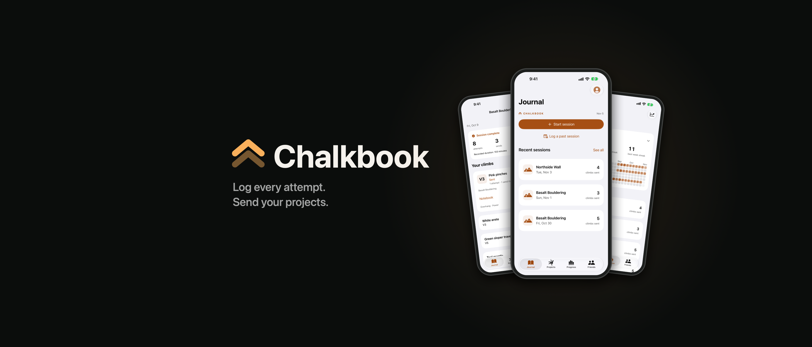
</p>

<h1 align="center">Chalkbook</h1>

<p align="center">
  <b>A bouldering journal for iPhone.</b> Log every attempt, track your projects across sessions, see your progress, and share sessions with friends.
</p>

<p align="center">
  
  
  
  
</p>

---

Chalkbook is a native iOS app I designed and built end to end: the SwiftUI client, the local data model and its migrations, the Supabase backend (schema, row-level security, edge functions), and the test suites for both. The journal works fully offline and without an account; Friends is an optional, privacy-first layer on top.

<p align="center">
  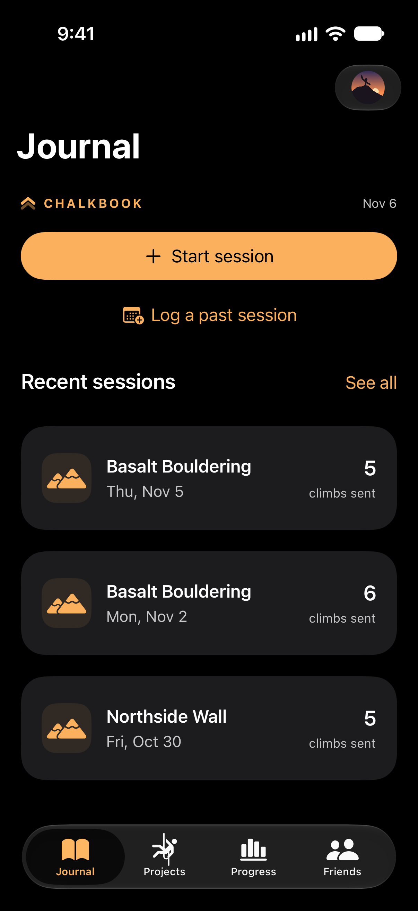
  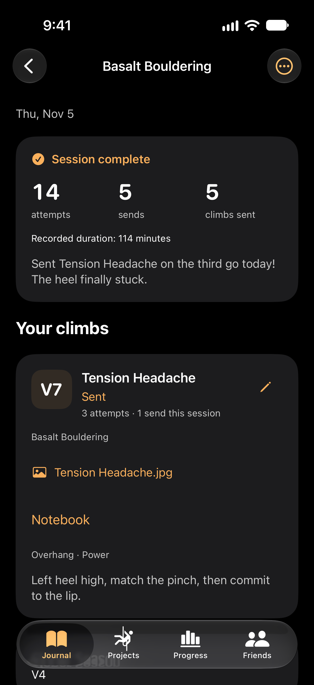
  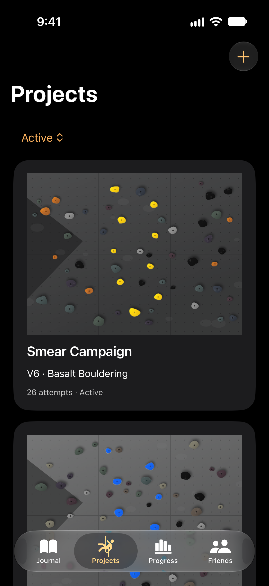
  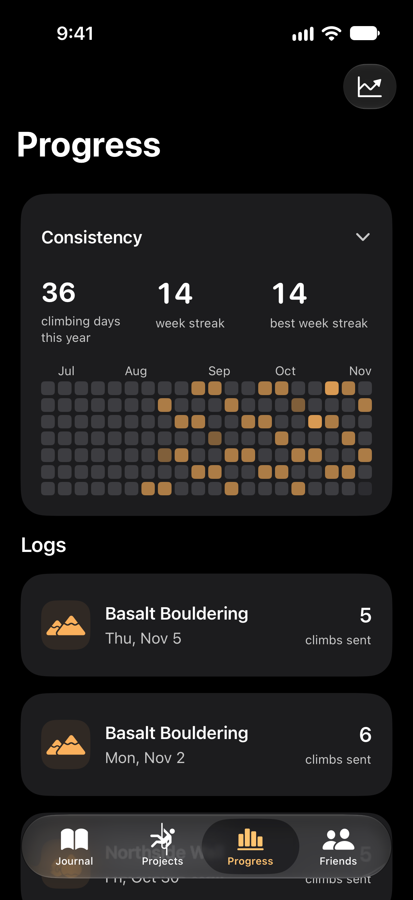
  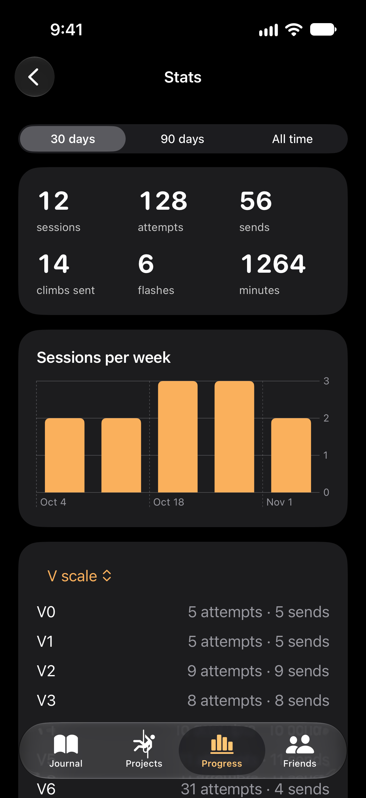
  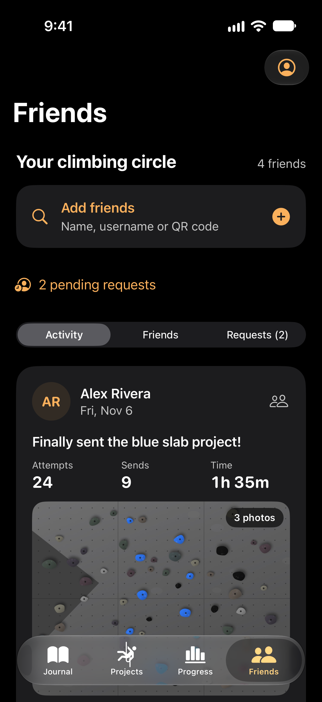
</p>

<sub>Screenshots and recordings use built-in demo data: the climbers, gyms and routes are made up.</sub>

## Feature walkthrough

### 1. Journal and sessions

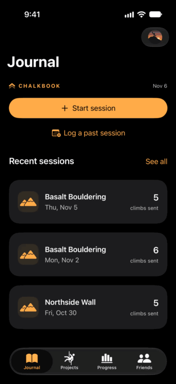

Start a session at your gym and log climbs as you go: grade, hold color, style tags, notes, and every attempt and send. Chalkbook tells a **flash** apart from a first-try send this session and from a repeat, so your numbers stay honest.

- Start, resume, backdate, edit and finish sessions; each keeps its calendar date and original time zone.
- Undo the latest attempt, correct outcomes after the fact, or log a whole-session recap when you didn't track individual attempts. Unknown values stay unknown instead of being guessed.
- Browse history by gym or by date.
- Optionally link an Apple Health climbing workout to a session (read-only).

<br clear="right">

### 2. Projects

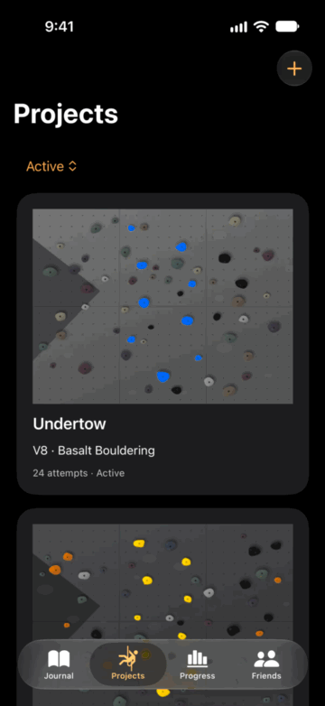

A project is a climb you keep coming back to. It follows you across sessions with its full attempt history and a private notebook.

- Attach up to three photos or videos per route from Photos or Files.
- **Hold highlighting:** tap a hold and Chalkbook dims everything that isn't that color, so the route stands out on a busy wall. It runs entirely on-device.
- Mark up route photos with private annotations, and pin your "next move" for the next session.

<br clear="right">

### 3. Progress and stats

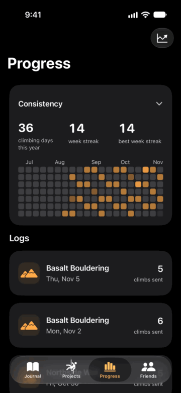

- A **consistency calendar** shows which days you climbed and your current streak.
- Stats over 30 days, 90 days or all time: sessions, attempts, sends, send rate, and your hardest send per grade scale, charted with Swift Charts.
- Grade scales (V-scale, Fontainebleau, or each gym's own custom scale) are kept separate and never silently converted.

<br clear="right">

### 4. Friends

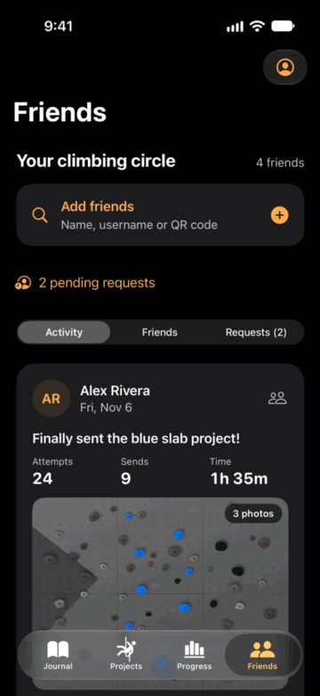

Friends is opt-in and built around review before anything leaves the phone.

- Mutual friend requests (no followers), username search, QR and link invites, and suggested friends.
- You choose what each shared session shows and who sees it: Private, Friends or Public. A preview shows exactly what will be published. Local notes, gym locations, Health data and original photos never leave the device.
- Reactions and comments on shared sessions.
- Safety: block, report, and full account deletion that cascades on the server and revokes Sign in with Apple.

<br clear="right">

### Also

- **Accounts:** Sign in with Apple or Google, or use the app as a guest. Each account keeps its own separate local journal.
- **Backups:** export a versioned JSON backup to Files, validate and preview it before restoring.
- **Gyms:** save gyms with Apple Maps place suggestions, a default gym, and a custom grade list per gym.
- **Accessibility:** Dynamic Type, VoiceOver labels and identifiers throughout, and 44-point touch targets.

## Tech stack

| Layer | What it uses |
|---|---|
| UI | SwiftUI, Observation, Swift Charts, PhotosUI, AVKit, MapKit |
| Local data | SwiftData with versioned schemas and migration plans; Keychain for credentials |
| Imaging | Core Graphics and ImageIO (hold highlighting, resizing, stripping photo location metadata), Core Image (QR invite codes) |
| Platform | HealthKit (read-only), Sign in with Apple, Google Sign-In (SPM) |
| Backend | Supabase: PostgreSQL with row-level security on every table, `SECURITY DEFINER` RPCs for mutations, Storage for shared photos |
| Edge functions | TypeScript on Deno: Apple token revocation on account deletion, moderation report alerts |
| Tests | XCTest unit and UI tests; backend permission tests in Node with PGlite (Postgres in WebAssembly) |

## Architecture

```
ClimbingApp/
├── App/          App entry point, launch arguments, bundled privacy policy
├── Domain/       Pure logic: grades, journal rules, progress math, calendar, hold detection
├── Data/         SwiftData models, schema versions V1 → V7, stores, JSON backup
├── Features/     SwiftUI screens: journal, sessions, projects, progress, settings
├── Health/       HealthKit workout reading and linking
├── Auth/         Apple and Google sign-in, per-account local stores
├── Social/       Friends: Supabase client, feed, sharing, invites, removal outbox
└── UI/           Theme and shared components
ClimbingAppTests/     Unit tests (domain, persistence, migrations, social, Health)
ClimbingAppUITests/   End-to-end UI journeys
supabase/
├── migrations/   Schema, RLS policies and RPCs, applied in order
├── functions/    Edge functions (Deno)
└── tests/        Permission tests against a real Postgres engine (PGlite)
web/              Privacy policy and friend-invite landing pages
scripts/          Dev tooling: simulator runner, screenshot capture, store art, icon
```

A few decisions worth calling out:

- **Offline first.** The journal is local SwiftData and never needs a network. Social features publish *reviewed snapshots*, not the journal, so a bad connection can't lose climbing data.
- **Honest data.** Attempts, sends and recaps are modeled separately so an aggregate recap never pretends to be individual attempts, and unknown totals stay unknown in the stats.
- **Safe migrations.** Every schema change is a new `VersionedSchema` with a migration stage, covered by tests that open older stores.
- **Removals can't get lost.** Unsharing or deleting a shared session first writes a durable, per-account removal outbox, then syncs it when online, with a visible pending state and retry.
- **Server-side authorization.** The app only holds a publishable key. Every read and write is enforced by Postgres row-level security, and the permission tests cover friends, privacy levels, blocks, reports, deletion and anonymous access.

## Running it locally

Requirements: Xcode 27, an iOS 17+ simulator.

```sh
git clone https://github.com/FROZENPOP/chalkbook.git
cd chalkbook
open ClimbingApp.xcodeproj   # scheme: ClimbingApp
```

The app runs as a guest with no configuration. Sign-in and Friends need your own provider keys, which live in two git-ignored files:

- `Configuration/Auth.local.xcconfig`: Apple team and Google client IDs. See [AUTH_SETUP.md](AUTH_SETUP.md).
- `ClimbingApp/Social/Supabase.local.json`: Supabase project URL and publishable key. See [SUPABASE_SETUP.md](SUPABASE_SETUP.md).

To see the app with demo data (debug builds only), add the launch arguments `--ui-testing --screenshot-demo`.

### Tests

```sh
# App unit and UI tests (pick any available simulator)
xcodebuild test -project ClimbingApp.xcodeproj -scheme ClimbingApp \
  -destination 'platform=iOS Simulator,name=iPhone 17'

# Backend permission tests (no hosted project needed)
cd supabase/tests && npm install && npm test
```

## Privacy

Chalkbook has no analytics, ads or tracking. The journal stays on the device unless you explicitly share a session. Read the full [privacy policy](web/privacy.html).

---

<p align="center">Designed and built by Shreyas Sindhaval. © 2026, all rights reserved.</p>
